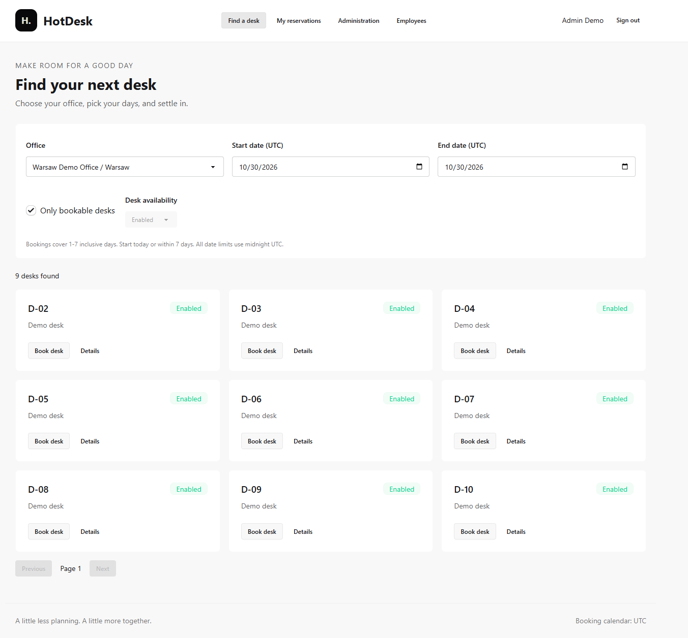
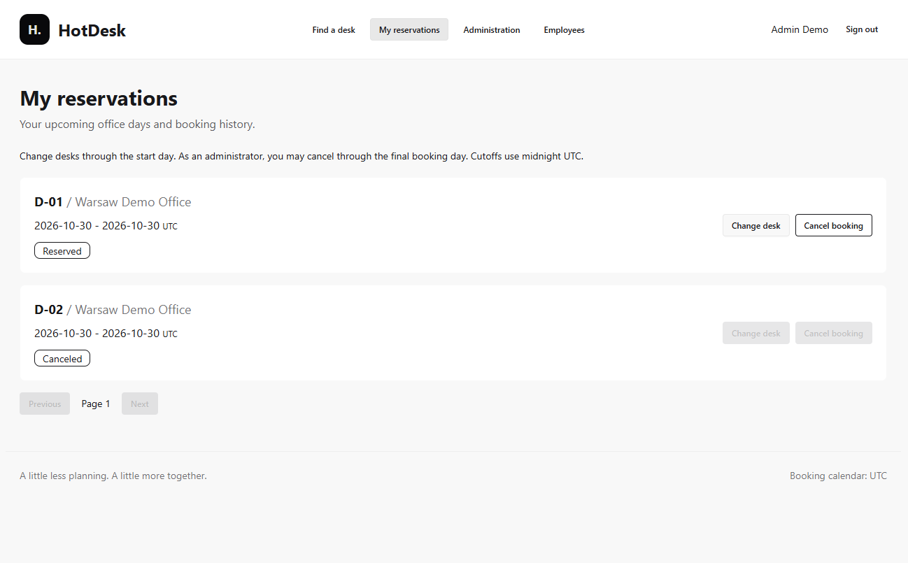
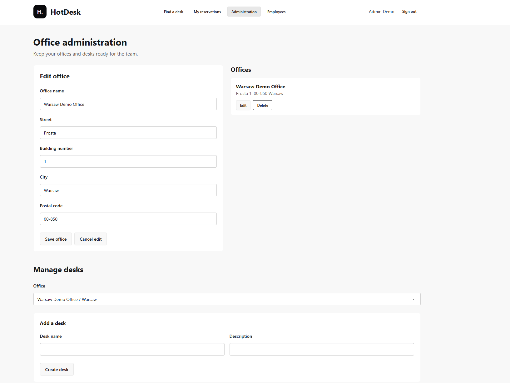
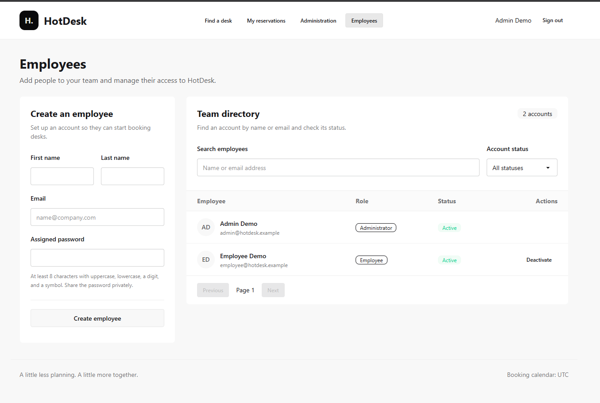

# HotDeskBooking

A desk booking app for offices. Employees find desks, book them for 1–7 days, and manage their reservations. Administrators manage offices, desks, and employee accounts.

[Tech stack](specs/tech-stack.md) · [Mission](specs/mission.md) · [Roadmap](specs/roadmap.md)

## Demo

[Open HotDeskBooking](https://nice-mushroom-05eb47a10.3.azurestaticapps.net/)

accounts demo: `admin@hotdesk.example` / `Test12345!` | `employee@hotdesk.example` / `Test12345!`

### Find a desk

### My reservations

### Office administration

### Employee management

Screenshots show the administrator view. Employee accounts can search for desks and manage their own reservations.

## Local run

Follow the [local development guide](local.md) to configure secrets, start the API and frontend, and try the demo accounts. HTTPS setup is optional.
